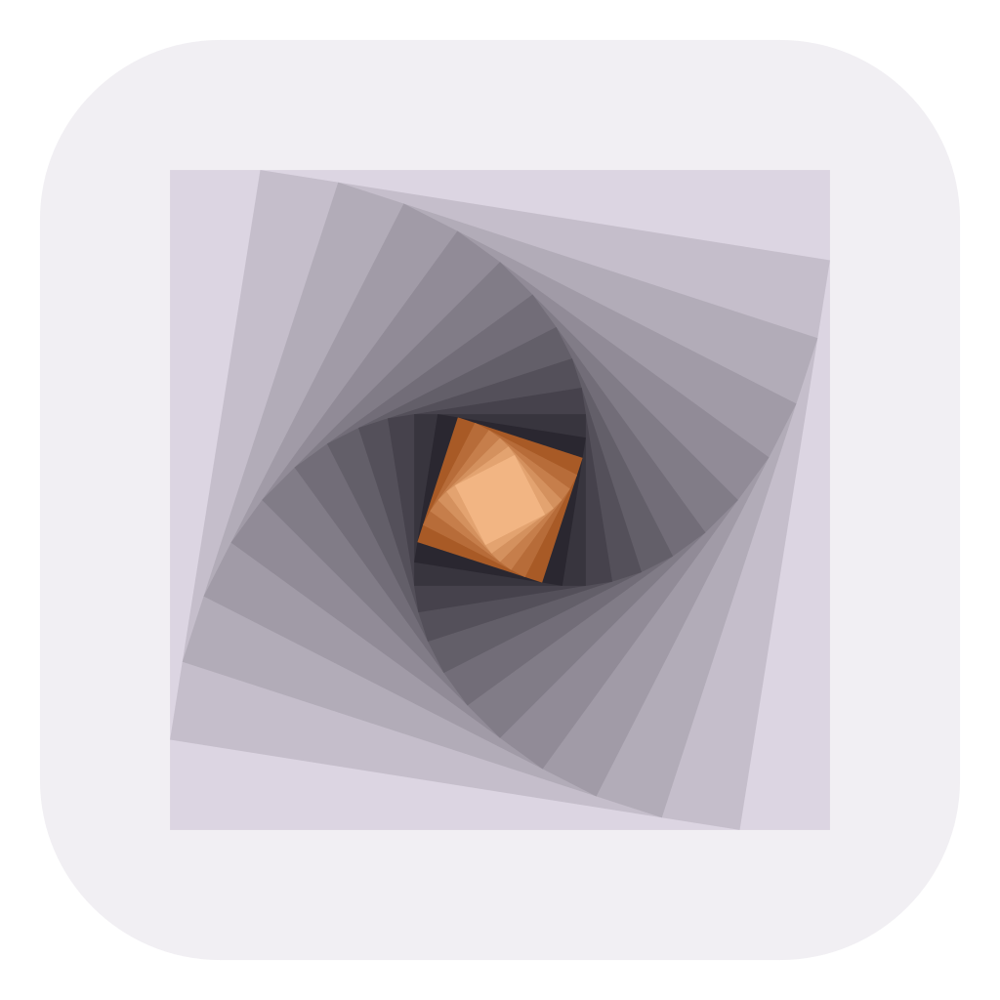
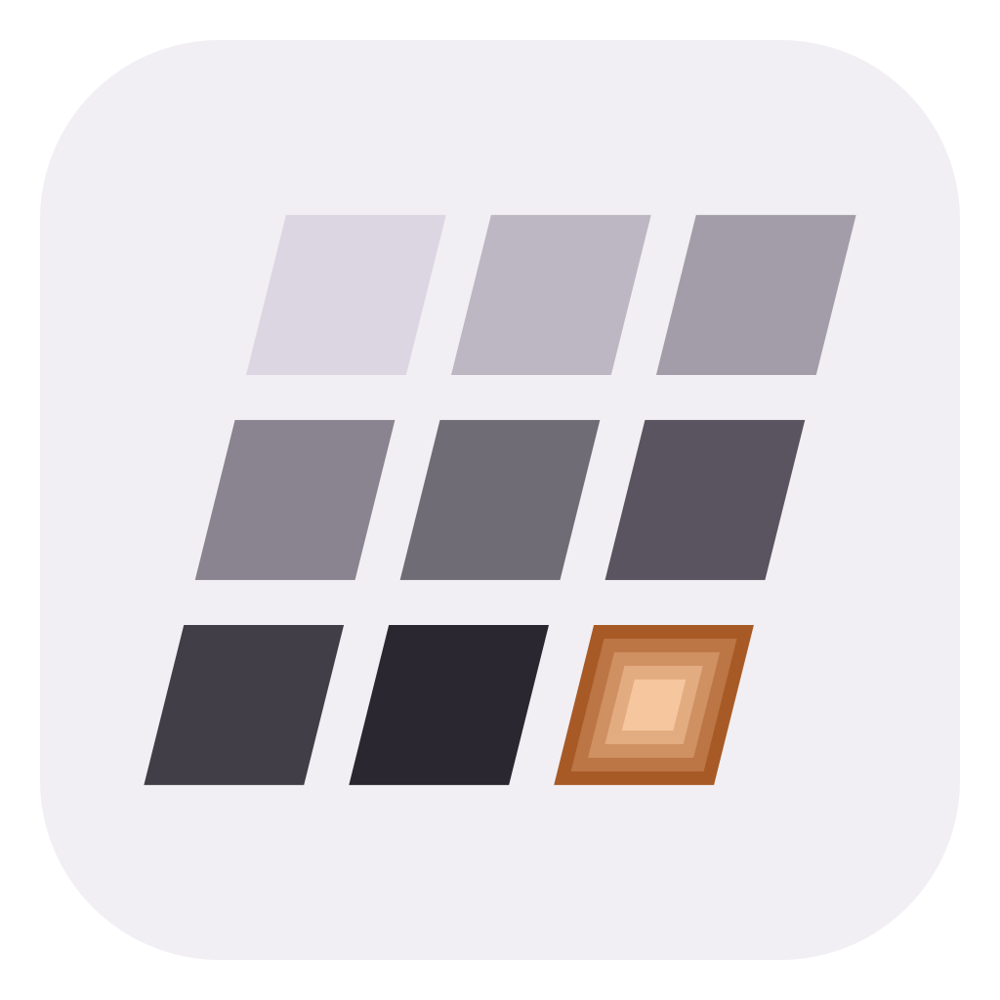

<div align="center">

<br>

<picture>
  <source media="(prefers-color-scheme: dark)" srcset="assets/brand/velocity-logo-on-dark.svg">
  <source media="(prefers-color-scheme: light)" srcset="assets/brand/velocity-logo-on-light.svg">
  
</picture>

### Intelligence with longer memory.

An independent AI company. We build intelligence that runs on your own hardware<br>and remembers far more than its window.

<a href="https://veloresearch.com">veloresearch.com</a> &nbsp;·&nbsp;
<a href="https://github.com/Veloresearch/impulse/releases/latest">Download Impulse</a> &nbsp;·&nbsp;
<a href="https://veloresearch.com/research/momentum">Research</a> &nbsp;·&nbsp;
<a href="https://x.com/velo_research">X</a> &nbsp;·&nbsp;
<a href="https://huggingface.co/velocity-research">Hugging Face</a>

</div>

<br>

## About Velocity

Velocity is independent. No big-tech parent, no cloud to rent your own data back to you. We do our
own research, build our own products and publish how we measure them.

We work on one problem: AI that remembers far more than it can see at once, fast enough to run on
the computer you already have. **Momentum** is that memory. **Impulse** is where you use it.

## Products

<table>
<tr>
<td width="50%" valign="top">

<picture>
  <source media="(prefers-color-scheme: dark)" srcset="assets/brand/impulse-icon.svg">
  
</picture>

### [Impulse](https://github.com/Veloresearch/impulse)

**Impulse** is the app for running AI models on your own computer. Load any GGUF model and chat
with web search, files, charts and voice, let it use your computer with your permission, or serve it
to your other apps through an OpenAI-compatible API and MCP. Momentum is built in.

Windows and Linux · NVIDIA, AMD and Intel graphics · free for personal use

[](https://github.com/Veloresearch/impulse/releases/latest)
[](https://github.com/Veloresearch/impulse/stargazers)

[Repository](https://github.com/Veloresearch/impulse) · [veloresearch.com/impulse](https://veloresearch.com/impulse)

</td>
<td width="50%" valign="top">

<picture>
  <source media="(prefers-color-scheme: dark)" srcset="assets/brand/momentum-icon.svg">
  
</picture>

### [Momentum](https://veloresearch.com/momentum)

**Momentum** is memory for local models: your knowledge, within reach. A model with an 8K-token
window works across up to **32 million tokens** of your documents, chats and code, on a laptop
graphics card. No embeddings, no vector database, nothing leaves the machine.

Built into Impulse, and available for businesses.

[Evaluation report](https://veloresearch.com/research/momentum) · [veloresearch.com/momentum](https://veloresearch.com/momentum)

</td>
</tr>
</table>

## Get Impulse

**Windows:** download the [installer](https://github.com/Veloresearch/impulse/releases/latest/download/ImpulseSetup.exe) (small, always fetches the newest version), or in PowerShell:

```powershell
irm https://github.com/Veloresearch/impulse/releases/latest/download/install.ps1 | iex
```

**Linux:** the [AppImage](https://github.com/Veloresearch/impulse/releases/latest/download/Impulse-x86_64.AppImage) or the [.deb](https://github.com/Veloresearch/impulse/releases/latest/download/impulse_amd64.deb) for Debian and Ubuntu, or in a terminal:

```bash
curl -fsSL https://github.com/Veloresearch/impulse/releases/latest/download/install.sh | sh
```

## How we work

- **Efficient first.** Better AI should not need more hardware, more memory and more energy.
- **Local by default.** Your models, your data, your computer.
- **Measured, not claimed.** Every number we publish comes with how we got it.
- **Ship early.** Previews go out often; [issues](https://github.com/Veloresearch/impulse/issues) shape what comes next.

<br>

<picture>
  <source media="(prefers-color-scheme: dark)" srcset="https://github.com/Veloresearch/impulse/raw/main/.github/stars-dark.svg">
  
</picture>

<p align="center"><sub>© 2026 Velocity · <a href="mailto:contact@veloresearch.com">contact@veloresearch.com</a></sub></p>
